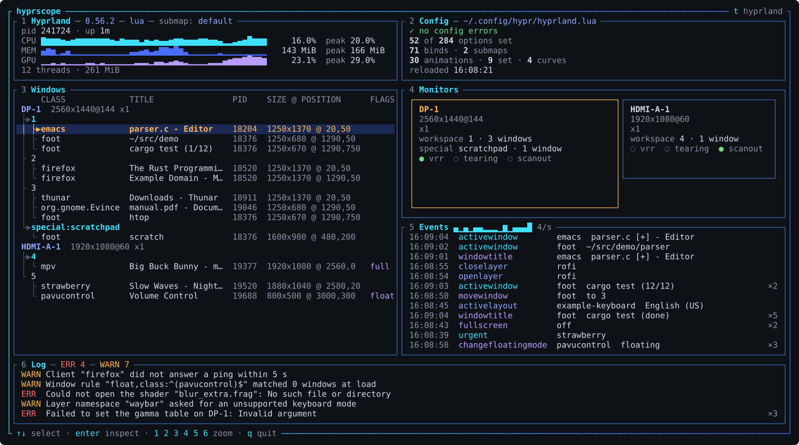

# hyprscope

hyprscope is a terminal program that shows Hyprland internals. It puts your windows,
monitors, the compositor's resource use, its events, its log warnings and your config
on one screen, live. It only reads from Hyprland and never changes anything.



Six panels. The number is the key that opens one full-screen.

| Key | Panel                                               |
|-----|-----------------------------------------------------|
| `1` | Hyprland: PID, uptime, CPU, memory and GPU history  |
| `2` | Config: errors, options set, binds, animations      |
| `3` | Windows: monitors, workspaces and windows as a tree |
| `4` | Monitors: layout, mode, scale, VRR                  |
| `5` | Events: Hyprland's event stream, repeats counted    |
| `6` | Log: Hyprland's recent warnings and errors          |

## Requirements

- A running Hyprland session. Built and run on Hyprland 0.56.
- A truecolour terminal of at least 116x32 (the `terminal` theme needs no truecolour).
- Rust 1.88 or newer, to build it.
- For the GPU row, a driver with per-process DRM counters (Intel, AMD). Otherwise it shows `n/a`.

## Install

```sh
cargo install hyprscope
```

Or from a clone:

```sh
git clone https://github.com/terminusarchive/hyprscope
cd hyprscope
cargo install --path .
```

## Use

| Option            | Action                   |
|-------------------|--------------------------|
| `-V`, `--version` | Print the version.       |
| `-h`, `--help`    | Print help.              |
| `--theme NAME`    | Start with theme `NAME`. |

| Key                                      | Action                                                 |
|------------------------------------------|--------------------------------------------------------|
| `Up` `Down` `k` `j`, `PageUp` `PageDown` | Select or scroll.                                      |
| `1`-`6`, `Enter`                         | Open a view; `Enter` opens Windows with its inspector. |
| `Esc`                                    | Back to the front page.                                |
| `/`                                      | Filter Windows, Events, Log or Config.                 |
| `Tab`, `a`                               | Config: next tab; options set or all.                  |
| `Space`, `r`, `l`                        | Events and Log: pause; Events raw form; Log level.     |
| `t`, `T`                                 | Next or previous theme. The choice is not saved.       |
| `q`, `Ctrl-C`                            | Quit.                                                  |

## Themes

`hyprland` (default), `synthwave`, `dracula`, `nord`, `gruvbox`, `catppuccin`,
`tokyo-night`, `solarized`, `monokai`, `one-dark`, `everforest`, `rose-pine`, `kanagawa`,
`ayu`, `night-owl`, `github-dark`, `palenight`, `solarized-light`, `gruvbox-light`,
`catppuccin-latte`, `github-light`, `mono`, `amber`, `green`, `paper`, `terminal`.

## Contributing and licence

See [CONTRIBUTING.md](CONTRIBUTING.md). MIT; see [LICENSE](LICENSE).
